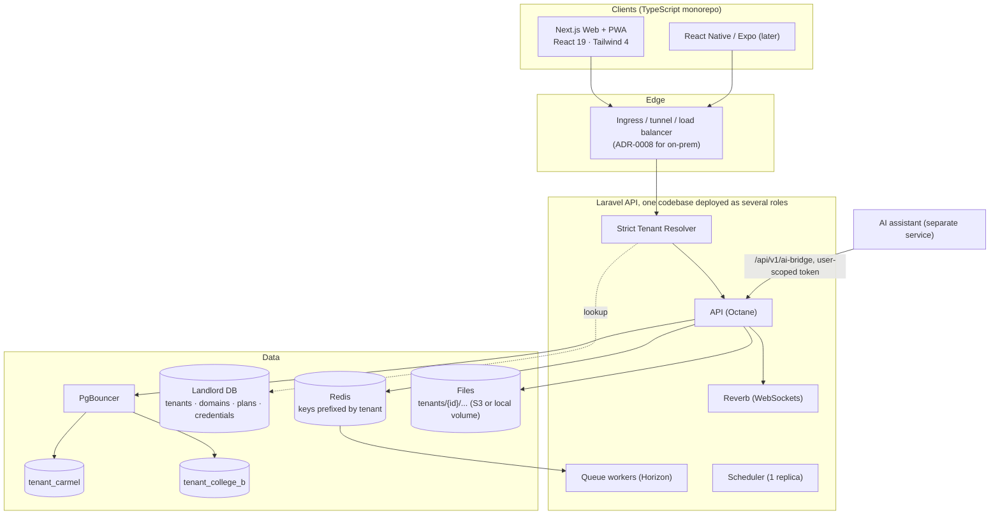
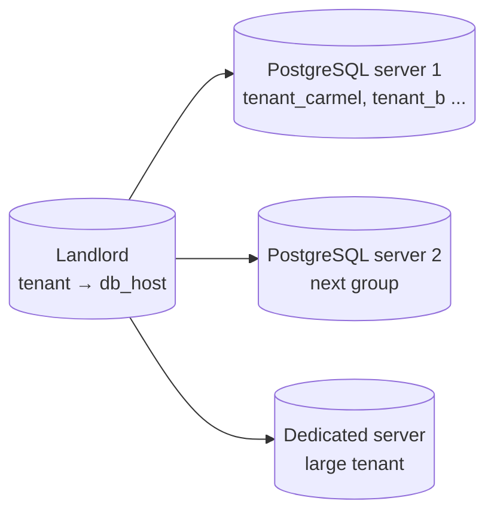
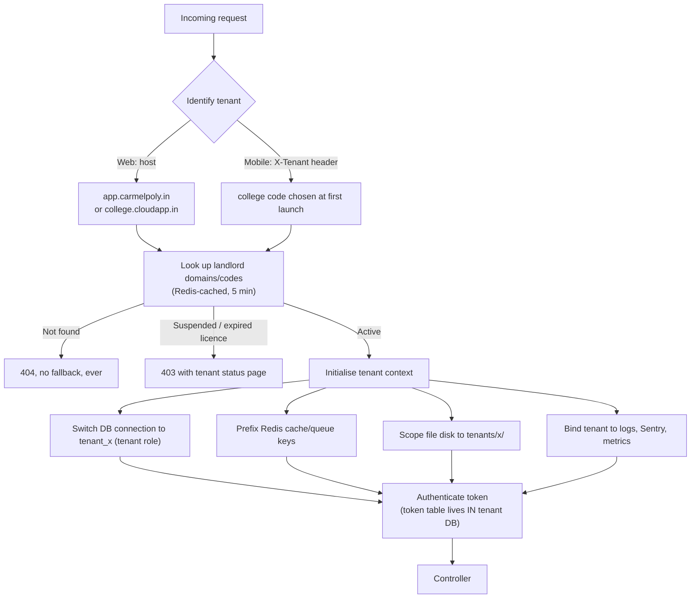
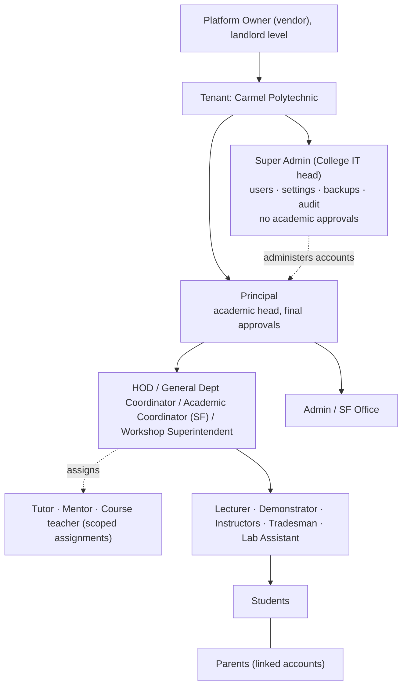
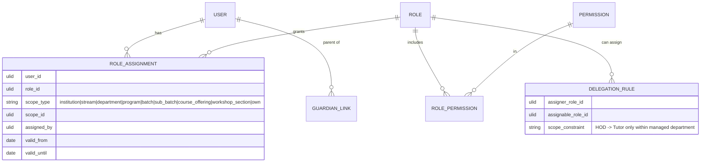
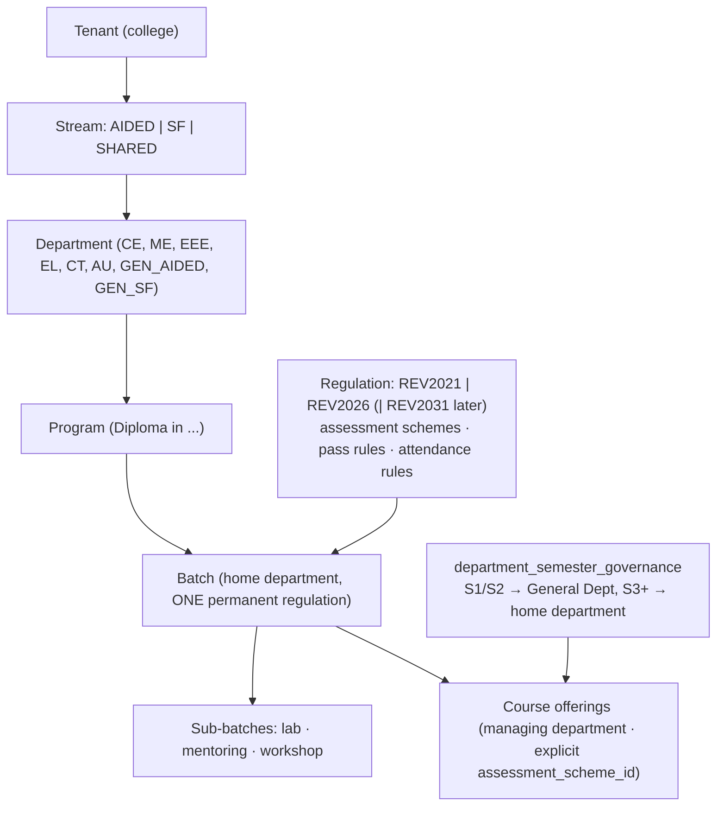
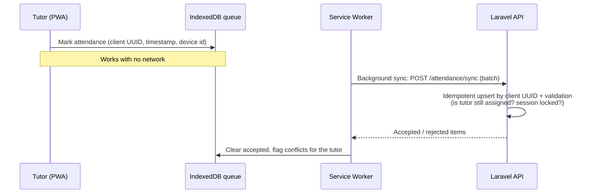
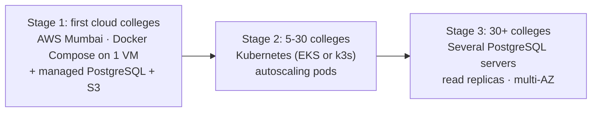
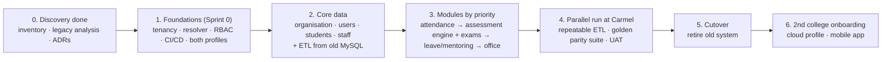

# Academic Management Suite: Target Architecture Blueprint (v3)

> Multi-tenant · **a separate locked PostgreSQL database for each college** · Laravel 12 headless API · Next.js web + PWA, React Native later · runs **on a college server or on AWS** from the same Docker images
> First market: **Kerala polytechnic colleges** (pilot: Carmel Polytechnic College) → engineering colleges later
> Status: aligned with ADR-0001 to ADR-0008. Where this file and an ADR disagree, the ADR wins.

### Decisions so far
| Topic | Decision |
|---|---|
| Tenant | One college |
| Isolation | **Database per tenant** in PostgreSQL 17. Identical schema, own DB role, `CONNECT` revoked from `PUBLIC` (ADR-0001) |
| Landlord | One central database: tenants, domains, plans/licences, per-tenant DB credentials, schema versions, platform users. Present in **both** profiles |
| Deployment | `onprem` (installed and updated by our team) and `cloud` (AWS), **both from day one**; a tenant can move between them (`tenants:export` / `import`) |
| Resolver | Strict: unknown tenant → 404, suspended → 403, never a default |
| Backend | Laravel 12, API only, **modular monolith** (ADR-001 in §12) |
| Clients | Next.js web + PWA (offline attendance) → React Native (Expo) → desktop only if needed |
| Roles | **Super Admin (college IT head) above Principal for system administration; no academic approvals** (ADR-0004) |
| Scope | Stream → department (home vs managing) → program → batch → sub-batch → course offering (ADR-0005) |
| Regulations | REV2021 and REV2026 run side by side as **data** in one assessment engine (ADR-0006) |
| Workflows & notifications | Stream-aware approval chains, in-app centre first, FCM later (ADR-0007) |
| AI assistant | **Separate project** (RAG), reached only via `/api/v1/ai-bridge/*` |
| Dropped | WebRTC remote support; virtual-classroom provider (live classes) is optional and later |

---

## 1. The Big Picture



---

## 2. Database-per-Tenant Design (PostgreSQL) (ADR-0001)

### Two kinds of database
| Database | Contains | Who connects |
|---|---|---|
| **Landlord** (`landlord`) | Tenants, domains, plans/licences, per-tenant DB host and credentials (encrypted), schema versions, platform-owner users, global reference data | Only the platform layer and the resolver |
| **Tenant** (`tenant_<slug>`) | Everything belonging to that college: users, roles, scopes, organisation, students, attendance, assessments, notifications, audit log | Only requests resolved to that tenant, using that tenant's DB role |

### Provisioning: the same schema, created automatically
```mermaid
sequenceDiagram
    participant PO as Platform Owner / installer
    participant L as Landlord
    participant J as Provisioning Job
    participant P as PostgreSQL
    PO->>L: Create tenant "Carmel Polytechnic" (slug: carmel, domain)
    L->>J: TenantCreated event
    J->>P: CREATE DATABASE tenant_carmel
    J->>P: CREATE ROLE tenant_carmel_u; REVOKE CONNECT ON DATABASE FROM PUBLIC; GRANT only on tenant_carmel
    J->>P: Run all tenant migrations (identical schema)
    J->>P: Seed roles, permissions, delegation rules, regulations, schemes, workflows
    J->>L: Mark tenant ACTIVE, store schema_version
    J-->>PO: Invite Super Admin (IT head); Principal account bootstrapped
```
Implementation: **stancl/tenancy v4**, multi-database. Sprint 0 verifies PostgreSQL per-role isolation support and adds a custom manager if needed.

> [!IMPORTANT]
> **Defence in depth.** Even if a bug ignored the tenant context, the DB role connected for College A cannot connect to College B's database. The isolation is enforced by the database server, not only by application code. A CI test proves it.

### Schema migrations across many databases
- Two migration folders: `database/migrations/landlord` and `database/migrations/tenant`.
- `tenants:migrate` runs across all tenants in batches; each tenant's `schema_version` is stored in the landlord DB.
- Migrations are **backward compatible** (expand → migrate → contract).
- CI: a fresh tenant database must equal a migrated one.

### Connections and scaling
Postgres connections are per database, so connection count scales with tenants × workers. **PgBouncer is mandatory** in both profiles, and tenant switching is tested under the chosen pool mode.


Each tenant record stores its `db_host`, so a tenant can move servers via dump → restore → update the landlord row. **On-prem is a landlord with one tenant**, same code.

### Moving between profiles
`tenants:export` (DB dump + files + tenant record) and `tenants:import` are supported commands, covered by a CI round-trip test.

---

## 3. Strict Tenant Resolver


Rules:
1. **No default tenant connection.** Landlord models explicitly use the `landlord` connection.
2. **Tokens are tied to a tenant by design** (Sanctum tokens in the tenant DB).
3. **Header and host must agree**; if they differ, reject.
4. **Queued jobs carry `tenant_id`**, re-initialise context on the worker, and fail closed without it.
5. **CI includes cross-tenant attack tests** through every endpoint group.

---

## 4. Roles: Platform Owner, Super Admin, Principal, and Scoped RBAC


- **Hierarchy is not a permission bundle.** "Above the Principal" means Super Admin can administer accounts and infrastructure; it does not grant leave approval, CIA locks or marks override (ADR-0004).
- The Principal appoints HODs and coordinators; HODs and General Dept Coordinators appoint Tutors, Mentors and Course teachers (ADR-0004). Roles and hierarchy are **seeded data**, so other institution types can have their own structures.
- Chairman is optional and read-only; Dean is not used for polytechnics.

### Model: `User + Role + Scope = Assignment` (inside each tenant database)

- Permissions are `<module>.<resource>.<action>`, declared in code and synced to the DB.
- `ScopeAuthorizer` uses **managing-department ancestry for write/governance** and **either home or managing ancestry for read/analytics** (ADR-0005).
- `GET /api/v1/me` returns assignments and capabilities (UI only); the API returns per-record `can_*` flags. Laravel enforces everything.

---

## 5. Academic Model: Kerala SBTE Polytechnic First, Pluggable Later


Polytechnic-specific features built into the core from the start:
- **Home vs managing department**: S1/S2 are governed by `GEN_AIDED` / `GEN_SF` while the batch's home branch stays CE/ME/etc. This is data, not `if ($semester <= 2)` code.
- **Course types**: theory, practical, practicum, drawing, workshop, project, seminar, english, health and physical education, internship.
- **Both R21 and R26** with every archetype as seeded data, including attendance slabs, eligibility, condonation and CO-PO mapping (NBA).
- **Typed sub-batches**: a student can be in one mentoring group, one workshop batch and one lab batch per practical offering.
- **Activity points** (60; 40 for lateral entry) as a per-regulation setting.
- **Official (SBTE) attendance** import and reconciliation, mock tests, series question papers.

---

## 6. Backend: Laravel 12 Modular Monolith

```
app/Core/        # Tenancy, Access, Organisation, Http, Audit, Files, Notify, Workflow, Settings
app/Modules/
  Platform/      # landlord: tenants, provisioning, plans              (landlord DB)
  Identity/      # users, parents, auth flows, role assignment          (tenant DB)
  Organisation/  # departments, programs, batches, sub-batches, governance
  Academics/     # courses, offerings, timetable (exclusion constraints), calendar
  Attendance/    # sessions, records, official attendance, offline sync
  Assessment/    # regulation engine, items, scores, CIA, consolidation
  Exams/         # question banks, series QPs, online and mock tests
  Mentoring/     # diary, activity points, no-dues
  Leave/         # student leave, staff leave, CCL, punches
  Office/        # SF office, documents, settings, backups UI
  Communication/ # notices, notifications UI
  Obe/           # course files, surveys, attainment, audits
  AiBridge/      # read-only retrieval surface for the external assistant
```
**Module boundary rules** (enforced in CI by Pest `arch()`):
- A module never uses another module's Models; it calls that module's `Contracts/` or listens to its `Events/`.
- Each module owns its routes, migrations, policies, tests.

Stack: Sanctum · Octane (FrankenPHP) · Horizon · Reverb · Scramble · Pennant · spatie/activitylog · spatie/laravel-query-builder · `brick/math` for deterministic marks arithmetic · `laragear/webauthn` · PgBouncer.

---

## 7. Frontend: Monorepo

```
apps/web       Next.js App Router · Tailwind 4 · shadcn/ui · PWA (Serwist) · English/Malayalam
apps/mobile    React Native (Expo), later
packages/api-client   generated from OpenAPI + TanStack Query hooks
packages/core         types, zod schemas, can() helpers, offline sync engine
packages/ui           shared tokens and components
```
- **Web auth (BFF):** Next.js server keeps the token in an httpOnly cookie and forwards the tenant host.
- **Dashboards are config-driven:** a widget registry filtered by capabilities and tenant modules. A Lecturer who is also a Tutor sees both sets.
- **The frontend never calculates marks or eligibility.**

---

## 8. Offline Attendance (PWA now, native app later)


- Timetable, roster and today's sessions are cached on the device.
- **Conflict rule:** the server decides. A locked session rejects late edits, shown to the tutor for an HOD override.
- The same sync engine in `packages/core` is reused by the Expo app.

---

## 9. Hosting: Two Profiles, One Image Set

### On-prem (Carmel first)
- Docker Compose on one server: nginx or Traefik, api, worker, reverb, web, PostgreSQL 17, PgBouncer, Redis. Assumed hardware: **high-end consumer PC** (final spec unknown), so add **UPS, scheduled encrypted backups, and a tested restore drill**.
- **Installed and updated by our team.** Update flow: signed image tag → `tenants:migrate` → smoke test. The college IT cell is notified, or we install directly. A remote backdoor is not required.
- Parents and students sign in from outside the campus, so public reachability, TLS and DDoS exposure need a decision (**ADR-0008**). Domain: `app.carmelpoly.in`.
- Offsite encrypted backups (S3 or Lightsail).

### Cloud

| Stage | Compute | Database | Notes |
|---|---|---|---|
| 1 | One EC2/Lightsail VM, Docker Compose | Managed PostgreSQL + PgBouncer, automated backups | Same images as on-prem |
| 2 | Kubernetes: `web`, `api`, `worker`, `reverb` Deployments + `scheduler` CronJob | Multi-AZ PostgreSQL, ElastiCache Redis | HPA on CPU/RPS, KEDA on queue length |
| 3 | More nodes | Tenants spread across servers by `db_host` | Large tenants on dedicated instances |

> [!WARNING]
> Kubernetes scales the **stateless** parts (API, workers, websockets). The database is the real bottleneck. Keep PostgreSQL managed and **outside** the cluster; protect it with Redis caching, queued writes for bursty operations (e.g. exam submissions), PgBouncer, and read replicas for reports.

**Containerise from day 1** (Dockerfiles, environment config, no local-only state, health checks) so the profiles and Kubernetes are deployment changes, not code changes.

---

## 10. Delivery Plan: Rebuild + Parallel Run + Cutover

The legacy Blade app is too flawed to evolve, so this is a **fresh codebase**. The old system keeps running at Carmel until the new one reaches feature parity.


- **The old MySQL data is required.** The ETL (`tools/etl`) is repeatable and idempotent, with a reconciliation report (row counts, checksum samples). Mobile numbers are converted to ULID relations.
- **R21 and R26 are both required** before cutover (other colleges follow them too). The assessment engine passes a **golden parity suite** built from de-identified Carmel snapshots across both regulations (ADR-0006).
- A **feature parity checklist** is signed off by Carmel stakeholders before cutover.

---

## 11. SaaS and Operations Concerns
| Concern | Approach |
|---|---|
| Plans and modules | Pennant flags per tenant; signed licence file on-prem |
| Onboarding | Provision tenant → bootstrap Super Admin and Principal → bulk CSV import (queued, job resource) |
| Branding | Logo, colours, custom domain per college |
| Support | Time-limited, audited, read-only-for-academic-roles impersonation (ADR-0004) |
| Data rights | Per-tenant export and deletion (DPDP Act), India-region hosting for cloud |
| Backups | Per-tenant backup and restore; restoring one college never affects another |
| Parent access | Real parent accounts, OTP or temporary password (ADR-0003); notification providers behind interfaces |
| AI assistant | Separate repo and service; read-only bridge; every query audited (ADR-0007) |

---

## 12. ADR-001: Modular Monolith over Microservices

**Status:** Decided · **Revisit when:** more than ~3 independent dev teams, or a module has clearly different runtime and scaling needs.

| Factor | Microservices | Modular monolith |
|---|---|---|
| **DB-per-tenant interaction** | N tenants × M services = N×M databases to provision, migrate, back up | N databases |
| **Domain coupling** | Attendance, assessment, timetable and results all rely on students/batches/courses, which become cross-service calls | In-process calls and DB transactions |
| **Consistency** | Sagas and eventual consistency | One DB transaction |
| **Scaling** | Each service separately | The same image runs as api/worker/reverb roles, each scaled separately |
| **On-prem fit** | Heavy to install on a college PC | One Compose stack |
| **Team fit** | Solves organisational scaling | Fits a small team |

**Candidates to extract later:** the AI assistant (already separate), PDF/QP rendering, reporting/analytics, notification fan-out.

---

## 13. ADR Index
| ADR | Title | Status |
|---|---|---|
| 0001 | PostgreSQL, one database per college | Decided |
| 0002 | API versioning, compatibility, long-running work | Decided |
| 0003 | Student, staff and parent authentication | Decided |
| 0004 | Super Admin (IT head) above Principal | Decided |
| 0005 | Scope tree with home and managing department | Decided |
| 0006 | Data-driven regulation and assessment engine | Decided (rule conflicts pending exam-cell confirmation) |
| 0007 | Approval chains, notifications, external AI boundary | Decided |
| 0008 | On-prem public reachability and TLS | Proposed |

---

## 14. Open Questions
1. **On-prem reachability** for parents outside the campus (ADR-0008).
2. **Exam-cell confirmation** of the R26 theory CIA floor, R21 theory ESE maximum, and the R26 Health & PE logbook mark (ADR-0006).
3. **Leave chains** for the Principal, `admin`, `sf_office` and `super_admin` as applicants.
4. **Final on-prem hardware** at Carmel and expected number of colleges in 12-24 months (capacity planning).
5. **Parent OTP provider** choice (Firebase Phone Auth, SMS gateway, or WhatsApp) and whether to start DLT registration now.
