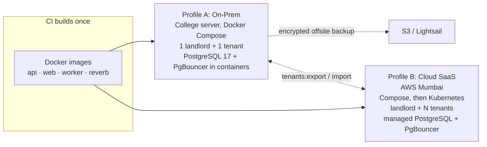
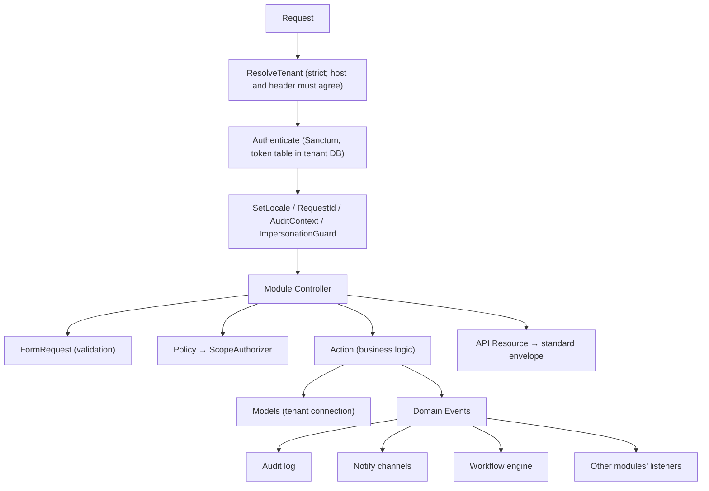
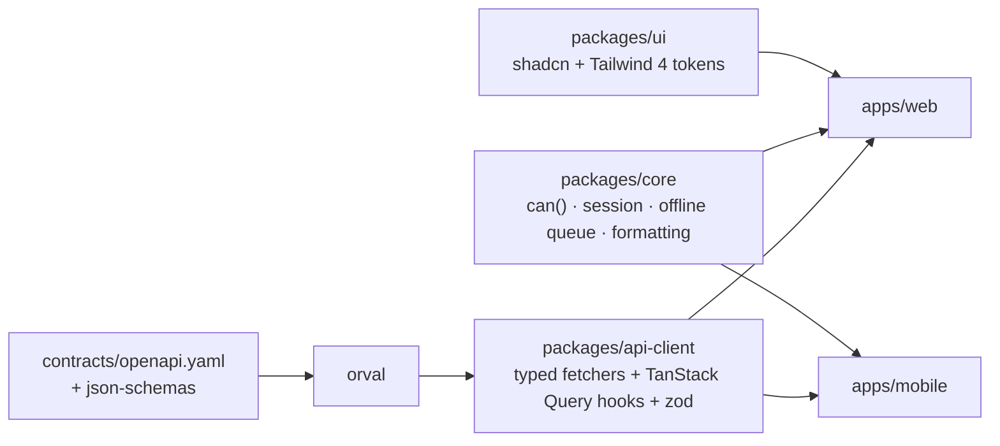
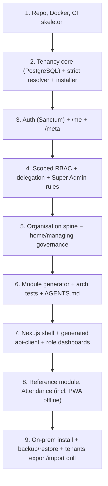

# Foundation Specification: Build This Before Porting Features

> Goal: a foundation strict enough that **AI agents can add modules safely**, flexible enough to run **on a college's own server or as cloud SaaS**, and ready to grow from 1 college to many.
> Status: aligned with ADR-0001 to ADR-0008 and `docs/glossary.md`. If this file and an ADR disagree, the ADR wins; fix this file.

---

## 0. Guiding Principles

| # | Principle | Why it matters |
|---|---|---|
| 1 | **One codebase, two deployment profiles** (`onprem` / `cloud`) | Carmel runs on its own server (installed and updated by us). Other colleges can use AWS. Both ship from day one. |
| 2 | **Tenancy is always on**, even with one college | On-prem is "a landlord with one tenant". No special code paths. |
| 3 | **One locked PostgreSQL database per college**, identical schema | Isolation is enforced by the database server, and a college can be exported and moved between profiles. |
| 4 | **The API contract is the source of truth** | Frontend types are generated from it, so agents cannot drift out of sync. |
| 5 | **Conventions enforced by CI, not by memory** | Small team + many AI agents = rules must be machine-checked. |
| 6 | **Every module looks the same** | A generator scaffolds modules; agents copy one proven pattern. |
| 7 | **Secure by default, fail closed** | No tenant, no permission, no data. |
| 8 | **Rules are data, not code** | Regulations, approval chains and role scopes are seeded rows, never `if ($subject->id == ...)`. |

---

## 1. Deployment Profiles (same images, different config) (ADR-0001)



| Setting | On-Prem | Cloud |
|---|---|---|
| `DEPLOY_PROFILE` | `onprem` | `cloud` |
| Installed/operated by | **Our team** (installs and updates; notifies the college IT cell, or installs directly) | Our team via CI/CD |
| Tenant creation | `php artisan app:install` | Platform Owner portal |
| Resolver | Locked to the single tenant's domain(s) | Host/header lookup |
| Updates | Signed image tag + `tenants:migrate` (scripted); remote access not mandatory | CI/CD rollout of Docker images |
| Licensing | Signed licence file (college, expiry, modules) | Plan row in the landlord DB |
| Backups | Scheduled encrypted `pg_dump`/WAL + files → offsite; restore drill | Managed snapshots + S3 versioning |
| Hardware assumption | High-end consumer PC; add UPS, scheduled encrypted backups, restore drill | n/a |
| Public reachability | Per ADR-0008 (parents sign in from outside the campus) | Load balancer / CDN |

> [!IMPORTANT]
> On-prem is **not a fork**. The only differences are environment variables and the installer. A tenant can move between profiles with `tenants:export` / `tenants:import` (supported feature, tested in CI).

---

## 2. Repository Layout (monorepo)

```
academic-suite/
├─ AGENTS.md                  # rules every AI agent must follow (see §7)
├─ docs/
│  ├─ adr/                    # architecture decision records (0001-0008 and growing)
│  ├─ legacy/                 # legacy codebase analysis (ROLE_AND_FEATURE_INVENTORY.md)
│  ├─ modules/<name>.md       # each module's purpose, entities, permissions
│  ├─ architecture_blueprint.md
│  ├─ decision_log.md
│  ├─ foundation_spec.md
│  ├─ glossary.md             # Batch, Sub-batch, Regulation, Tutor... exact meanings
│  └─ role_and_permission_spec.md
├─ backend/                   # Laravel 12
│  ├─ app/Core/               # foundation (tenancy, access, organisation, http, audit, notify, workflow)
│  ├─ app/Modules/<Module>/   # feature modules, generated, uniform
│  ├─ database/migrations/landlord/   database/migrations/tenant/
│  └─ tests/Architecture/     # boundary rules
├─ frontend/                  # pnpm + Turborepo
│  ├─ apps/web/               # Next.js + PWA
│  ├─ apps/mobile/            # React Native (Expo), later
│  └─ packages/{api-client,core,ui,config}
├─ contracts/
│  ├─ openapi.yaml            # generated from backend, committed, diffed in CI
│  └─ json-schemas/           # JSON column shapes (scheme trees, rubrics, rules)
├─ deploy/
│  ├─ docker/  compose/onprem/  compose/cloud/  k8s/
├─ tools/etl/                 # legacy MySQL → PostgreSQL ETL (repeatable, idempotent)
└─ .github/workflows/
```
The AI assistant (RAG) is a **separate repository and service**; it only talks to `/api/v1/ai-bridge/*` (ADR-0007).

---

## 3. Backend Core (`app/Core`): the actual foundation



### 3.1 Tenancy (`Core/Tenancy`) (ADR-0001)
- **stancl/tenancy v4**, multi-database, PostgreSQL 17. Sprint 0 verifies whether it ships a permission-controlled PostgreSQL manager; if not, we write one.
- Provisioning creates database `tenant_<slug>` and a dedicated role, **revokes `CONNECT` on the database from `PUBLIC`** (Postgres grants it by default), runs tenant migrations, seeds roles, permissions, delegation rules, regulations, schemes and workflows, records `schema_version`.
- Landlord tables: `tenants`, `domains`, `tenant_databases` (host, name, encrypted creds), `licenses`/plans, `platform_users`, `schema_versions`. The landlord exists in **both** profiles.
- Pool with **PgBouncer** (connections scale with tenants × workers). Verify tenant switching under the chosen pool mode.
- Bootstrappers: database, cache prefix, queue (tenant id in payload, jobs without a tenant fail closed), filesystem (`tenants/{id}/`), logs/Sentry context.
- Commands: `app:install`, `tenants:create`, `tenants:migrate`, `tenants:backup`, `tenants:export`, `tenants:import`, `tenants:move`.

### 3.2 Identity & Scoped RBAC (`Core/Access`) (ADR-0003, ADR-0004)
Tenant tables:
```
users (type: staff|student|parent), user_profiles, guardian_links
roles(key, name, level)                  -- 21 tenant roles, seeded
permissions(key)                          -- <module>.<resource>.<action>, e.g. attendance.session.mark
role_permission
role_assignments(user_id, role_id, scope_type, scope_id, assigned_by, valid_from, valid_until)
delegation_rules(assigner_role, assignable_role, scope_constraint)
```
- One central check: `Gate::authorize('attendance.session.mark', $courseOffering)`. `ScopeAuthorizer` resolves the resource's scope ancestry and applies **ADR-0005**: governance/write/approval permissions match the **managing-department** path; read/analytics permissions match **either** the managing or home department path.
- Assigning roles goes through `AssignRoleAction`, which checks `delegation_rules`. The Principal appoints HODs and coordinators; HODs and General Dept Coordinators appoint Tutors, Mentors and Course teachers within their managed scope; Super Admin bootstraps accounts and acts on appointments only on a recorded Principal order.
- **Super Admin** (college IT head) holds `identity.*`, `office.system_settings.*`, `office.backup.*`, audit view; **no** academic or HR approvals. Impersonation needs a reason, is time-limited (max 30 min), audited, and is **read-only** for academic and HR-approval roles (middleware blocks mutating verbs). MFA is mandatory.
- **Permissions are declared in code** by each module (`Module::permissions()`) and synced to the DB by a command. Agents never invent permission strings.
- Passwords: Argon2id, no universal default, random single-use initial credentials with forced change. Passkeys via `laragear/webauthn` (full FIDO2 verification); TOTP or passkey as second factor.

### 3.3 Organisation Spine (`Core/Organisation`) (ADR-0005, ADR-0006)
```
institution
 └─ stream (AIDED | SF | SHARED)          -- attribute of departments; also a scope type
     └─ departments(funding_stream, ...)   -- incl. GEN_AIDED, GEN_SF
         └─ programs
regulations(REV2021 | REV2026, config)  → assessment_schemes (archetypes)
academic_years
batches(home_department_id, regulation_id, current_semester, ...)  -- one permanent regulation
  ├─ sub_batches(kind: lab | mentoring | workshop, course_offering_id?)
  └─ course_offerings(batch, semester, course, managing_department_id, assessment_scheme_id)
courses(code, regulation_id, type)
department_semester_governance(home_department_id, semester_from, semester_to, managing_department_id)
workshop_sections
```
There is **no generic `sections` table**; use typed `sub_batches`. A semester promotion action re-resolves `managing_department_id` and archives S1/S2 tutor assignments when crossing S2 to S3.

### 3.4 API Standards (`Core/Http`) (ADR-0002)
- Prefix `/api/v1`, JSON only, **ULIDs** as public IDs.
- Envelope `{ data, meta, links }`; errors in RFC 7807 `{ type, title, status, detail, errors }`.
- `spatie/laravel-query-builder` conventions: `?filter[x]=&sort=-created_at&include=batch&page[size]=25`.
- `Idempotency-Key` on retried POSTs; offline attendance is idempotent on the client UUID.
- `GET /api/v1/meta`: server/API version, min client version, capabilities, deprecations. Compatibility window **N-1**.
- Long-running work returns `202` + `/api/v1/jobs/{id}`: one shared job resource (imports, ETL, PDFs, bulk upload).
- JSON-column shapes have JSON Schemas in `contracts/json-schemas/`, validated on write; TypeScript types generated.
- Per-record flags (`can_edit`, `can_lock`) in resource `meta`; `/me` capabilities are for navigation only.
- Per-tenant rate limits and token scopes.
- OpenAPI generated by **Scramble**, committed to `contracts/openapi.yaml`.

### 3.5 Cross-Cutting
| Concern | Choice |
|---|---|
| Audit | Every Action that changes data emits a domain event stored by `spatie/laravel-activitylog` (who, what, before/after, impersonator if any). AI-bridge queries log with `source = 'ai_assistant'`. |
| Files | `Core/Files`: presigned upload, virus-scan hook, per-tenant quota |
| Notifications | `Core/Notify`: `notifications` table + in-app centre first (Reverb with polling fallback); channels behind `NotificationChannelContract` (`InAppChannel`, `MailChannel`, `FcmPushChannel`, `SmsChannel`, `WhatsAppChannel`); all external delivery queued (ADR-0007) |
| Workflow | `Core/Workflow`: data-driven `workflow_definitions` per (type, funding stream, applicant role category), for staff leave, CCL, student leave, CIA consolidation (ADR-0007) |
| Settings | Per-tenant settings with typed accessors (attendance thresholds, activity points 60 / 40 LET, branding) |
| Feature flags | Pennant, driven by licence or plan |
| Realtime | Reverb, private channels `tenant.{id}.*` |
| AI bridge | Read-only `/api/v1/ai-bridge/*`; same `ScopeAuthorizer` as the web UI |
| Scheduler | One job scheduler, including scheduled flash notices (rebuilt properly) |

---

## 4. Module Contract (the template agents follow)

`php artisan make:module Attendance` generates:
```
app/Modules/Attendance/
  AttendanceModule.php        # registers routes, permissions, events, menu/widgets
  Contracts/                  # PUBLIC interfaces other modules may call
  Actions/                    # one class = one use case (MarkAttendanceAction)
  Http/Controllers/  Http/Requests/  Http/Resources/
  Models/                     # PRIVATE to this module
  Policies/  Events/  Listeners/  Jobs/
  Database/Migrations/  Database/Factories/  Database/Seeders/
  Tests/Feature/  Tests/Unit/
  README.md                   # purpose, entities, permissions, events
```
MVP modules: Identity, Organisation, Attendance (offline), Assessment (regulation engine), Exams (incl. mock tests), StudentPortal/ParentPortal, Notifications, Leave, Mentoring (incl. activity points), Office. Later: SF Office extras, staff birthdays, mobile push, WhatsApp.

**Hard rules (enforced by Pest `arch()` tests):**
1. Other modules may use only `Contracts/`, `Events/`, and `Http/Resources/`, **never** `Models/`.
2. Controllers contain no business logic: validate → authorize → Action → Resource.
3. Every route has a policy check, enforced by a test that lists all routes.
4. Every Action has a feature test, including a **cross-tenant test** and an **unauthorised-role test**.
5. No `DB::connection('landlord')` outside `Core/Tenancy` and `Modules/Platform`.
6. No hard-coded role names, course IDs or regulation codes in logic.

---

## 5. Frontend Foundation


- **Next.js App Router**, server components for data-heavy pages, BFF route handlers for auth (httpOnly cookie). Mobile uses tokens.
- **App shell** built from a **module registry** (`{ key, route, icon, requiredPermission, widgets[] }`), filtered by `/me` capabilities. Per-record actions use `meta` flags from the API.
- **Forms**: react-hook-form + zod generated from the API.
- **PWA**: Serwist + Dexie offline queue in `packages/core`, used first by attendance.
- **Notification centre** in the top bar and `/notifications` (Reverb, polling fallback).
- The frontend **never computes CIA totals or eligibility**; it renders what `CalculateCourseCiaAction` returns.
- **Tenant branding**: CSS variables from `/api/v1/tenant/branding`; bilingual (English / Malayalam) strings.

---

## 6. Quality Gates (CI)

```mermaid
flowchart LR
    PR["Pull request"] --> L["Lint + format<br/>Pint · ESLint · Prettier"]
    L --> S["Static analysis<br/>Larastan level 8 · tsc strict"]
    S --> A["Architecture tests<br/>module boundaries"]
    A --> T["Tests<br/>Pest (parallel, 2 test tenants) · Vitest"]
    T --> I["Isolation + schema<br/>cross-tenant attack suite · fresh DB equals migrated DB"]
    I --> C["Contract check<br/>openapi + json-schemas diffed · api-client builds · N-1 compatibility"]
    C --> E["E2E smoke<br/>Playwright: login per role"]
    E --> M["Merge → build images → staging"]
```


Extra gates: **golden parity suite** for the assessment engine (ADR-0006) once Assessment lands; `tenants:export` / `import` round-trip test; migrations checked for expand → migrate → contract.

---

## 7. `AGENTS.md`: Rules for Your AI Agents (starter)

```markdown
# Rules for AI agents
- Read docs/glossary.md, relevant docs/adr/*, and the target module's README.md before coding.
- New feature = new Action + FormRequest + Policy check + Resource + Pest feature test.
- Never access another module's Models; use its Contracts or Events.
- Never query the landlord connection outside Core/Tenancy or Modules/Platform.
- Every new endpoint: add a cross-tenant test and an unauthorised-role test.
- Permissions are <module>.<resource>.<action>, declared in <Module>Module::permissions(); never hard-code role names in logic.
- Governance/write checks use managing_department; read checks may use home_department too (ADR-0005).
- Never hard-code subject IDs, course codes or regulation rules; use assessment_schemes and workflow_definitions.
- The frontend never calculates marks; the backend Action does.
- Long-running work returns 202 + /api/v1/jobs/{id}.
- After backend API changes: run `composer contract` then `pnpm gen:api`; commit both.
- Migrations must be backward compatible (expand → migrate → contract) and work on a fresh tenant DB.
- Do not edit app/Core without an ADR in docs/adr/.
- Definition of done: `composer check && pnpm check` passes.
```

---

## 8. Sprint 0: Build Order & Exit Criteria



| Step | Done when… |
|---|---|
| 1 | `docker compose up` brings up api, web, postgres, pgbouncer, redis. CI runs on PR. |
| 2 | `app:install` creates landlord + `tenant_carmel`. Unknown host returns 404; suspended tenant 403. The tenant's DB role **cannot connect** to any other database (test, including the `PUBLIC` revoke). Fresh DB equals migrated DB (CI). |
| 3 | Login per tenant works. A token from tenant A is rejected on tenant B (test). `/meta` reports versions and capabilities. |
| 4 | Principal assigns HOD; HOD assigns Tutor only within own department; Super Admin cannot assign HOD without a recorded order; impersonating an academic role is read-only (tests, 403s). |
| 5 | Departments → batches → sub-batches CRUD. Tests: Gen Dept Coordinator can act on CE S2 but not CE S4; CE HOD can read CE S2 but not unlock it. SBTE seed and both regulations seeded. |
| 6 | `make:module` output passes all architecture tests unchanged. |
| 7 | Logging in as each role shows a different nav and dashboard, driven by capabilities only. |
| 8 | Tutor marks attendance offline, it syncs once, duplicates are ignored, and a locked session rejects edits. |
| 9 | Fresh on-prem server installed from the script in under 30 min. A tenant restored from backup on another machine. A tenant exported from `onprem` and imported to `cloud` (and back) with matching row counts and checksums. |

After Sprint 0, **porting = generating a module and filling in Actions**, mapped from the old schema through `tools/etl`. The assessment engine is the critical path and starts only after these exit criteria pass.

---

## 9. Version Pins (late 2026, confirm at setup)
PHP 8.4 · Laravel 12 · **PostgreSQL 17** (18 once tested; same major in both profiles) · PgBouncer · Redis 7 · stancl/tenancy 4 · Sanctum 4 · `laragear/webauthn` · `pragmarx/google2fa` · `brick/math` · Octane (FrankenPHP) · Horizon · Reverb · Pest 3 · Larastan · Node 22 LTS · Next.js 15/16 · React 19 · Tailwind 4 · TanStack Query 5 · orval · Serwist · Playwright · pnpm + Turborepo

## 10. Open Items
- ADR-0008 (on-prem public reachability and TLS) needs a decision.
- stancl/tenancy v4 PostgreSQL role isolation: verify in Sprint 0.
- Exam-cell confirmation of the three rule conflicts in ADR-0006.
- Leave chains for Principal, `admin`, `sf_office` and `super_admin` applicants (ADR-0007 gap).
