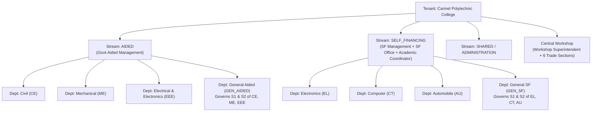

# Definitive Role, Permission & Regulation-Engine Specification

> Derived from `ROLE_AND_FEATURE_INVENTORY.md` (4,293 lines, 50 controllers / 56,996 LOC, 588 routes, 132 MySQL tables).
> This is the **exact blueprint** for `Core/Access`, `Core/Organisation`, and `Modules/Assessment` in the new PostgreSQL + Laravel 12 + Next.js stack.

---

## 1. What the Code Inventory Revealed (Critical Findings)

### 1.1 Architectural Reality vs. Target
| Legacy Reality | New Foundation |
|---|---|
| **No `users` table, no Laravel Auth guard, no Middleware, no Policies.** 588 routes in a single `routes/web.php` checking `Session::get('userRole')` with inconsistent string arrays. | Single `users` table (ULID PK) + Laravel Sanctum + strict `ResolveTenant` middleware + Laravel Policies + `ScopeAuthorizer`. |
| **12 separate Virtual Classroom Controllers (28,697 lines)** and ~60 duplicated `r21_*` / `r26_*` tables. | **1 Assessment Engine + 1 Virtual Space module** driven by `assessment_schemes` / `assessment_components` rows in PostgreSQL (ADR-0006). |
| **Foreign keys were intentionally dropped** (`2026_07_19_000003_drop_classroom_foreign_keys.php`) because R21 lived in `class_management` and R26 in `r26_class_management`. | Single `batches` table with `regulation_id` FK. Full PostgreSQL referential integrity restored. |
| **5 competing attendance tables** synthesized via copy-pasted logic across 8+ controllers, plus `class_logs_attendance` storing JSON arrays requiring full-table memory scans. | Normalized `attendance_sessions`, `attendance_records`, and `official_attendance_summaries` with a single `AttendanceCalculator` service. |
| **Timetables and Day Order stored as flat JSON files** in `storage/app/timetables/*.json`. | Relational `timetable_slots` with PostgreSQL **exclusion constraints** (prevents double-booking staff or rooms). |
| **Offline PWA attendance was never actually implemented** (`public/sw.js` only handled push; attendance required live `fetch`). | Real IndexedDB (`Dexie`) + Service Worker (`Serwist`) outbox syncing to idempotent `POST /api/v1/attendance/sync`. |

### 1.2 Critical Security Flaws in Legacy (Eliminated by Design in New Stack)
1. **Plaintext passwords** intentionally stored across `students` and `staff_profiles` for `/superadmin/show-users`, plus universal default password `carmel2026`. $\rightarrow$ **Argon2id hashing only; `/superadmin/show-users` replaced by audited password-reset / one-time invite links.**
2. **Global CSRF exemption on `login` and `api/*`** while using cookie sessions. $\rightarrow$ **Sanctum stateful SPA CSRF protection + token auth for mobile.**
3. **Unauthenticated endpoints**: `/api/notifications/broadcast`, `CourseFileController` grade writes, `/api/users/online-status`. $\rightarrow$ **Every `/api/v1/*` route requires auth + policy check (enforced by CI test).**
4. **Broken WebAuthn**: never verified cryptographic signature or challenge—knowing a `credentialId` logged you in. $\rightarrow$ **`laragear/webauthn` with full FIDO2 cryptographic verification.**
5. **Spoofable SF Face Punch + IDOR**: client-side RGB skin-pixel heuristic, skipped check if `face_descriptor` omitted, and accepted `staff_id` from POST body. $\rightarrow$ **Authenticated user ID only from token; server-side verification + signed device attestation.**
6. **Parent Portal Takeover**: auto-bound any 10-digit phone if `guardian_mobile` was empty; static MD5 token with `'CarmelR26ParentSecret'` and `'demo'` bypass. $\rightarrow$ **Guardian phone set only by Tutor/Admin or verified student profile; signed expiring magic links / OTP.**
7. **Unescaped `shell_exec` to Python** for PDF parsing inside HTTP requests. $\rightarrow$ **Queued background jobs (`Horizon`) calling isolated parser worker.**

---

## 2. Organisational & Stream Hierarchy (`Core/Organisation`)

The inventory uncovered a vital polytechnic nuance: **First-Year General Departments (`GEN_AIDED` and `GEN_SF`) govern Semesters 1 & 2 (`S1/S2`) across the engineering branches of their stream**, while the engineering HODs govern `S3–S6` (and overall branch ownership).



### Scope Tree (PostgreSQL `ltree`, two paths per batch)
Every resource belongs to a node in this hierarchy, enabling instant ancestor/descendant permission checks. Because a batch has two parents (home and managing department), batches and course offerings store **two ltree paths**: `home_path` and `managing_path` (ADR-0005).
```
institution
 ├── stream (AIDED | SF)
 │    └── department (CE, ME, EEE, EL, CT, AU, GEN_AIDED, GEN_SF)
 │         └── program (Diploma in ...)
 │              └── batch (e.g. ME 2024-2027, linked to Regulation R21 or R26)
 │                   ├── sub_batch (Lab Batch 1 / 2, Mentoring Group A / B, Workshop Batch 1 / 2)
 │                   └── course_offering (Batch + Semester + Course)
 └── workshop_section (Machine Shop, Fitting, Smithy, Welding, Sheet Metal, Foundry)
```
> **Read vs governance (ADR-0005):** write/governance/approval permissions are checked against `managing_path` only; read/analytics permissions match `managing_path` **or** `home_path`. The managing department comes from `department_semester_governance`, not code.
>
> **S1/S2 General Department Rule**: A `course_offering` or `batch` in Semester 1 or 2 has `managing_department_id = GEN_AIDED` (for CE/ME/EEE) or `GEN_SF` (for EL/CT/AU), while retaining `home_department_id = CE/ME/...`. That way, General Dept Coordinators automatically get HOD-level control over S1/S2 without ugly `if ($branch === 'GEN_AIDED')` hacks.

---

## 3. Complete Role Catalogue & Scopes (`Core/Access`)

All **21 tenant roles** (plus Platform Owner at landlord level; Tutor, Mentor and Course teacher are scoped assignments rather than designations) normalized from the 30+ legacy string variants:

| # | Role Key | Display Name | Scope Type | Stream | Singleton? | Notes / Legacy Mapping |
|---|---|---|---|---|---|---|
| 0 | `platform_owner` | Platform Owner | Landlord | All | No | Your company (SaaS ops, tenant provisioning). |
| 1 | `super_admin` | Super Admin (College IT head) | `institution` | Both | No | Above the Principal for system administration. Users, settings, backups, audit, online monitor, MFA mandatory. **No academic or HR approvals.** Impersonation is audited and read-only for academic/HR-approval roles (ADR-0004). |
| 2 | `principal` | Principal | `institution` | Both | **Yes (1 active)** | Head of institution. Academic authority: final Aided leave approver, CIA approval. Appoints HODs, coordinators, workshop superintendent. |
| 3 | `chairman` | Chairman | `institution` or `stream` | Configurable | No | Optional executive role (disabled by default; shares executive KPIs & notices). |
| 4 | `admin` | Office Admin | `institution` or `stream` | Configurable | No | Office administration: staff/student records, documents, notices. **Backups and system settings belong to Super Admin.** Cannot assign HOD or coordinators. |
| 5 | `academic_coordinator` | Academic Coordinator (SF) | `stream` (`SF`) | `SF` | **Yes (per stream)** | **Overlay or primary role** (can be held by an SF HOD/Lecturer). Stage-2 (final) SF leave approver; SF-wide academic oversight. Stream is carried by scope, not by role key. |
| 6 | `gen_dept_coordinator` | General Dept Coordinator | `department` (`GEN_AIDED` or `GEN_SF`) | Stream of dept | **Yes (1 per Gen Dept)** | Replaces `Gen_Dept_Coordinator_Aided` & `Gen_Dept_Coordinator_Self_Finance`. Acts as HOD for S1/S2 of that stream (managing department). Stream is carried by the department scope, not by role key. |
| 7 | `sf_office` | SF Office Superintendent | `stream` (`SF`) | `SF` | No | SF leave quota verification, backfill, CCL ledger, punch logs, fee/salary desk. |
| 8 | `hod` | Head of Department | `department` | Dept's stream | **Yes (1 active per dept)** | Manages dept staff & students, creates batches, assigns Tutors/Mentors/Subject staff, locks CIA, Stage-1 leave approver. |
| 9 | `workshop_superintendent` | Workshop Superintendent | `workshop_section` (all) + `institution` (batch upload) | Both | **Yes (1 active)** | Oversees central workshop, trade sections, workshop staff, and first-year workshop batches. |
| 10 | `tutor` | Class Tutor (Mentor-1) | `batch` | Batch's stream | **Yes (1 primary per batch)** | **Assigned by HOD** to a Lecturer/staff. Approves batch students, roll nos, leave, activity points, special attendance, submits CIA to HOD. |
| 11 | `mentor` | Batch Mentor (Mentor-2) | `batch` or `sub_batch` (`A`/`B`) | Batch's stream | No | **Assigned by HOD/Tutor**. Manages assigned mentees' 9-tab Mentoring Diary & leave. |
| 12 | `course_teacher` | Subject / Course Staff | `course_offering` (with sub-role: `primary`, `co_staff`, `lab_instructor`, `assistant`) | Course's stream | No | **Assigned by HOD**. Marks attendance, lesson plans, assessments, QPs, course files. |
| 13 | `lecturer` | Lecturer | `department` | Dept's stream | No | Base teaching designation. Only role eligible for R26 Practicum 1-hour theory slots. |
| 14 | `demonstrator` | Demonstrator | `department` | Dept's stream | No | Lab/Practical instruction & evaluation. |
| 15 | `workshop_instructor` | Workshop Instructor | `department` / `workshop_section` | Dept's stream | No | Workshop trade instruction & evaluation. |
| 16 | `trade_instructor` | Trade Instructor | `department` / `workshop_section` | Dept's stream | No | Trade/Lab instruction & evaluation. |
| 17 | `tradesman` | Tradesman | `department` / `workshop_section` | Dept's stream | No | Trade/Lab assistance & evaluation. |
| 18 | `laboratory_assistant` | Laboratory Assistant | `department` | Dept's stream | No | Lab maintenance & assistance (fixed legacy bug where HOD couldn't manage them and desktop login failed). |
| 19 | `physical_instructor` | Physical Instructor | `stream` / `institution` | `AIDED` or `SF` | No | Evaluates R26 Health & Physical Education (`1009`) & sports activities. |
| 20 | `student` | Student | `own` (`student_id`) | Batch's stream | — | Student portal, exams, assignments, surveys, diary, leave, activity points. |
| 21 | `parent` | Parent / Guardian | `own` (`student_id` link) | — | — | Read-only ward attendance, marks, tasks, remarks (bilingual English/Malayalam). Real user account (`type = parent`) linked via `guardian_links` (ADR-0003). |

---

## 4. Delegation Matrix (Who Can Assign / Approve Whom)

Stored in `delegation_rules` and enforced by `AssignRoleAction` and `ApproveUserAction`:

| Assigner / Approver Role | Can Create / Approve / Manage Users & Assign Roles | Scope Constraint |
|---|---|---|
| `super_admin` | `principal` (bootstrap), `admin`, `sf_office`, all base staff designations, all students; `hod`, coordinators, `workshop_superintendent` **only on a recorded Principal order** | `institution` |
| `principal` | `hod`, `gen_dept_coordinator`, `academic_coordinator`, `workshop_superintendent`, `sf_office`, `admin`; all base staff designations and students | `institution` |
| `admin` | Base staff designations and students (create/approve). **Not** `hod`, coordinators, `workshop_superintendent` or `principal` | `institution` or own stream |
| `academic_coordinator` | View/manage staff & students in `SF` stream | `stream = SF` |
| `hod` | `lecturer`, `demonstrator`, `workshop_instructor`, `trade_instructor`, `tradesman`, `laboratory_assistant`, `physical_instructor`, `student`; can assign `tutor`, `mentor`, `course_teacher` | Own `department` (managing department for the batches concerned) |
| `gen_dept_coordinator` | `tutor`, `mentor`, `course_teacher` for S1/S2 batches of their stream | Managing department `GEN_AIDED` or `GEN_SF` |
| `workshop_superintendent` | `workshop_instructor`, `trade_instructor`, `tradesman`, `demonstrator`, `laboratory_assistant` + bulk student upload | `workshop_section` / institution-wide workshop batches |
| `tutor` | Approve/suspend/reset password for `student`; split mentoring `sub_batch` (Group A/B) and assign `mentor`; assign roll numbers | Own supervised `batch` |

---

## 5. Permission Catalogue (~80 Permissions Across 10 Modules)

Permissions follow `<module>.<resource>.<action>`. Roles are bundles of permissions; scopes filter *which* records they apply to. `super_admin` holds `identity.*`, `office.backup.manage`, `office.system_settings.manage`; it never holds `assessment.*` approvals or `office.staff_leave.approve_*` unless it also has an explicit academic role assignment.

1. **`identity.*`**: `user.view`, `user.create`, `user.update`, `user.unlock` (Super Admin only: administratively clears multi-tier rate limiter lockouts; separated from `user.update` to prevent privilege escalation), `user.approve`, `user.suspend`, `user.delete`, `user.reset_password`, `user.impersonate` (audited, time-limited, read-only across all target roles), `role.assign`, `online_status.view`, `audit_log.view`.
2. **`organisation.*`**: `department.manage`, `batch.view`, `batch.create`, `batch.promote_semester`, `batch.graduate`, `batch.delete`, `batch.assign_tutor`, `batch.assign_mentor`, `batch.manage_roll_numbers`, `batch.bulk_import_students`, `course_offering.manage`, `course_offering.assign_staff`, `timetable.manage`, `day_order.set`, `academic_calendar.manage`.
3. **`attendance.*`**: `session.mark`, `session.unlock`, `session.quick_log`, `session.override_grid`, `official_teams.import`, `official_teams.override`, `special_duty.grant`, `relaxation.toggle`, `condonation.view`, `certificate.print`, `own.view`, `student_leave.apply`, `student_leave.approve`, `parent_alert.log`.
4. **`teaching.*`**: `syllabus.upload`, `lesson_plan.manage`, `lesson_plan.ai_generate`, `material.manage`, `material.view`, `remedial.manage`.
5. **`assessment.*`**: `component.configure`, `marks.enter`, `marks.override`, `marks.lock_category`, `experiment.manage`, `workshop_batch.setup`, `project_group.manage`, `seminar.register_topic`, `seminar.evaluate`, `ese.enter`, `cia_consolidated.view`, `cia_consolidated.submit_tutor`, `cia_consolidated.lock_hod`, `progress_report.view`, `own_marks.view`.
6. **`exams.*`** (QP & Online Tests): `question_bank.manage`, `question_bank.ai_generate`, `series_qp.manage`, `series_qp.ai_generate`, `online_test.manage`, `online_test.attempt`, `mock_test.attempt`.
7. **`obe.*`** (Course Files, Surveys, Attainment): `course_file.manage`, `course_file.audit`, `survey.manage`, `survey.respond`, `co_po.calculate`, `program_attainment.manage`, `sbte_audit.manage`, `nba_audit.manage`, `professional_activity.manage`.
8. **`mentoring.*`**: `sub_batch.assign`, `diary.view`, `diary.edit_own`, `diary.counseling_log`, `diary.disciplinary_manage`, `activity_point.claim`, `activity_point.verify`, `nodue.view`.
9. **`office.*`** (HR, Leave, SF Office, Biometric Punch): `staff_leave.apply`, `staff_leave.verify_office`, `staff_leave.approve_hod`, `staff_leave.approve_coordinator`, `staff_leave.approve_principal`, `staff_leave.backfill`, `ccl.credit`, `ccl.view_ledger`, `punch.enroll_face`, `punch.clock`, `punch.manage_geofence`, `punch.audit_report`, `sf_settings.manage`, `backup.manage`, `system_settings.manage`.
10. **`communication.*`**: `flash_notice.broadcast`, `dept_notice.manage`, `campus_event.manage`, `notification.view_own`, `ai_assistant.ask`, `birthday.wish` (backlog). *(WebRTC support desk dropped.)*

---

## 6. The Regulation-Driven Assessment Engine (`Modules/Assessment`)

This is how we replace **12 controllers (28,697 lines) and ~60 tables** with **one engine** while keeping **100% of R21 and R26 rules intact**.

### 6.1 Every Course Archetype Discovered in the Inventory

| # | Archetype Key | Reg | CIA + ESE = Total | Pass Minimums (CIA / ESE / Total) | Attendance Mark Formula | Component Tree (stored as `assessment_components` rows) |
|---|---|---|---|---|---|---|
| 1 | `r21_theory` | R21 | `50 + 75 = 125` | `20/50` · `30/75` (Grade E) · `50/125` | Proportional `/10`, rounded to `1.0` | **Formative** (`20M` = `best_k_of_n(2, 4)` of CO1..CO4 `/20`) + **Summative Series** (`20M` = `best_k_of_n(2, 4)` of CO1..CO4 `/20`) + **Attendance** (`10M`) |
| 2 | `r21_practical` | R21 | `75 + 50 = 125` | `30/75` · `20/50` · `50/125` | Proportional `/15`, rounded to `0.5` | **Lab Work** (`37.5M` = avg of $N$ experiments `/37.5` across 5 rubrics `5+7.5+7.5+7.5+10`, supports direct `/37.5` override with proportional back-calc) + **Micro-Project/OEE** (`7.5M`) + **Series Tests** (`15M` = avg of T1, T2 `/15`) + **Attendance** (`15M`) |
| 3 | `r21_drawing` | R21 | `75 + 50 = 125` | `30/75` · `20/50` · `50/125` | Proportional `/15`, rounded to `0.5` | **Sheets** (`37.5M` = avg of sheets `/100` [`50+50`] scaled to `37.5`, nearest `0.5`) + **Open-Ended** (`7.5M`) + **Series Tests** (`15M` = avg of T1, T2 `/100` [`40+30+20+10`] scaled to `15`) + **Attendance** (`15M`) |
| 4 | `r21_workshop` | R21 | `75 + 50 = 125` | `30/75` · `20/50` · `50/125` | Proportional `/15`, rounded to `0.5` | 2 Batches $\times$ 3 Trade Sections (Batch 1: Fitting, Smithy, Welding; Batch 2: Machine shop [4 works], Sheet metal [2 works + Alum], Foundry). **Trade Work** (`37.5M` = 3-section avg of works `/20` scaled to `37.5`) + **Record** (`7.5M` = 3-section avg of Rough `10` + Fair `10` scaled to `7.5`) + **Trade Tests** (`15M` = 3-section avg `/15`) + **Attendance** (`15M`) |
| 5 | `r21_major_project` | R21 | `75 + 50 = 125` | `30/75` AND `20/50` AND `50/125` | Proportional `/15`, rounded to `0.5` | 5 COs, Project Groups. **CIA**: Formative Diary (`30M`) + Summative Dept Review (`30M`) + Attendance (`15M`). **ESE**: 8 rubrics (5 Group + 3 Individual: `10+5+7.5+2.5+7.5+7.5+5+5 = 50M`). |
| 6 | `r21_seminar` | R21 | `75 + 0 = 75` | `30/75` AND `report > 0` | Proportional `/7.5`, rounded to `0.5` | 3 COs, Multi-Assessor Committee Average: Relevance (`7.5`) + Literature (`7.5`) + Presentation (`37.5`) + Interaction (`7.5`) + Report (`7.5`, **must be > 0**) + Attendance (`7.5`). |
| 7 | `r26_theory` | R26 | `40 + 60 = 100` | `(16/40)` configurable, see note · `24/60` · `40/100` | R26 6-tier slab `/5` | **Attendance** (`5M`) + **Self-Learning CA1–CA4** (`15M` = avg of 4 COs `/15` [`5+5+5`], nearest `0.5`) + **Series 1 & 2** (`20M` = S1 [CO1 `25` + CO2 `25` = `50` $\rightarrow$ `20`] & S2 [CO3 `25` + CO4 `25` = `50` $\rightarrow$ `20`] averaged, nearest `0.5`) |
| 8 | `r26_practical` | R26 | `60 + 40 = 100` | `24/60` · `16/40` · `40/100` | R26 6-tier slab `/5` | **Day Work Table 2.2** (`30M` = avg of exps `/50` [`10+10+5+10+10+5`] scaled to `30`) + **Open-Ended Table 2.3** (`10M` = `/50` [`10x5`] scaled to `10`) + **Series Table 3.1** (`15M` = avg of S1, S2 `/40` [`10+15+5+5+5`] scaled to `15`) + **Attendance** (`5M`) |
| 9 | `r26_practicum_basic` | R26 | `40 + 60 = 100` | `16/40` · `24/60` · `40/100` | R26 6-tier slab `/5` | Physics/Chemistry (`2001–2003`, supports dual Section A/B). **CIA (`40M`)**: Att (`5M`) + Self-Learning M1–M4 (`5M` from `/10`) + Continuous Practical (`10M` from `/50`) + Theory Series (`10M` from `/50`) + Practical Series (`10M` from `/40`). **ESE**: `60M` Theory only. |
| 10 | `r26_practicum_core` | R26 | `40 + 100 = 140` | `16/40` · `24/60` Theory ESE · `56/140` | R26 6-tier slab `/5` | Same `40M` CIA as above + **ESE `100M`** (`60M` Theory + `40M` Practical). |
| 11 | `r26_drawing` | R26 | `40 + 60 = 100` *(or `60+40` lab mode)* | `16/40` · `24/60` · `40/100` | R26 6-tier slab `/5` | Active mode: Att (`5M`) + CA1–CA4 (`15M`) + Series 1 & 2 (`20M` from `/40`). Also supports slot/CAD/OEE rubric breakdown. |
| 12 | `r26_english_1001` | R26 | `40 + 60 = 100` | `16/40` · `24/60` · `40/100` | R26 6-tier slab `/5` | Att (`5M`) + CA1 Self-Learning M1–M4 (`5M` from `/10`) + CE M1–M4 (`10M` from `/50`) + CA2/CA3 Practical Tests (`10M` from `/40`) + CA4/CA5 Series (`10M` from `/50`). Direct attainment uses `40:60` CIE:ESE and 7 POs. |
| 13 | `r26_health_1009` | R26 | `60 + 40 = 100` | `24/60` · `16/40` · `40/100` | R26 6-tier slab `/5` | Att (`5M`) + 8 Activities (`30M` from `/50` across 5 dynamic criteria) + 2 Fitness Tests CA1/CA2 (`15M` from `2 x /40`) + Logbook (`10M`). *(Fixes legacy bug where logbook 10M was omitted from sum).* |

> **No More Hard-Coded Subject ID Hacks**: In the legacy code, `AU 3055` (`id=110`, Production Drawing) and `CT 5002` (`id=147`, Project Management) had to be excluded from Drawing/Project by hard-coding their database IDs in 4 files! In the new design, each `course_offering` has an explicit `assessment_scheme_id` column—so `AU 3055` simply points to `r21_theory`.

> **Canonical archetype list: these 13 keys** (6 R21 + 7 R26, discovered in the inventory). They are archetypes, not routing rules: a `course_offering` points at one explicitly through `assessment_scheme_id`. Any R26 workshop/project/internship schemes are **not in the legacy inventory** and are added later as seed data when those syllabi are loaded.
>
> **Pending exam-cell confirmation** (legacy code disagrees with itself): (1) R26 theory CIA minimum: `16/40` in `ConsolidatedCiaReportController`, absent in `R26ClassroomController`; (2) R21 theory ESE max `75` vs `100` displayed in the consolidated report; (3) R26 Health & PE (`1009`): Logbook 10M is defined but omitted from the legacy sum (effective max 50 instead of 60). Defaults live in `pass_rules_json` so each can change without code. The golden parity suite will show exactly which Carmel results change.

### 6.2 How the Engine Schema Works (8 Tables Instead of ~60)
**Canonical schema is ADR-0006.** Eight tables:

`regulations`, `assessment_schemes`, `assessment_components` (tree), `course_outcomes`, `co_po_mappings`, `assessment_items`, `assessment_scores`, `cia_summaries`.

Supporting tables owned by the Assessment module: `cia_consolidations (batch_id, semester, status: draft|submitted_by_tutor|locked_by_hod, tutor_id, submitted_at, hod_id, locked_at)` and `project_or_seminar_registrations (course_offering_id, group_no, student_id, guide_user_id, topic, files_json, metadata_json)`.

---

## 7. Related Documents

1. `architecture_blueprint.md` (v3): target architecture
2. `foundation_spec.md`: Sprint 0 foundation and agent rules
3. `docs/adr/0001` to `0008`: decisions
4. `docs/glossary.md`: exact meanings
5. `current_system_analysis.md` and `ROLE_AND_FEATURE_INVENTORY.md`: legacy reference
